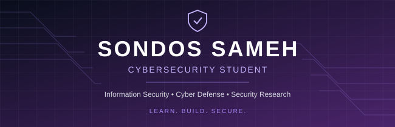

<!-- PROFILE BANNER -->

## 👩‍💻 About Me

I'm a Cybersecurity student interested in information security, threat analysis, and cyber defense.

I am developing my technical skills through hands-on labs, practical projects, and continuous learning, with a focus on understanding security threats and building effective defenses.

- 🎓 Cybersecurity Student

- 🔐 Interested in Security Engineering and Cyber Defense

- 💻 Exploring practical cybersecurity tools and technologies

- 🌍 Based in Egypt

- 🚀 Open to internships and learning opportunities

## 🛡️ Areas of Interest

## 🛠️ Technical Skills & Tools

**Programming & Scripting**

 
ion security, threat an
  
labs, practical projects,
  
practical projects, and continuous 
   

## 📊 GitHub Statistics

## 📈 Contribution Activity

## 🌐 Connect with Me

